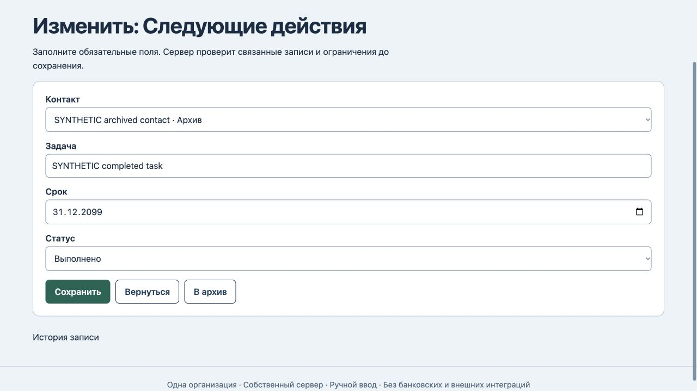
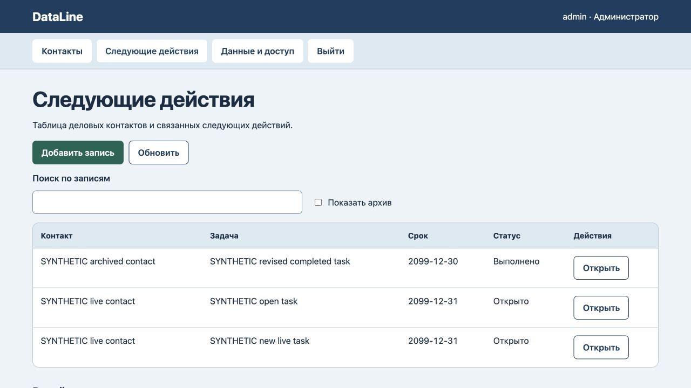

# DataLine: редактирование завершённой истории

25 октября2026. В прежней форме завершённого действия пропадал выбранный архивный контакт: обязательное поле становилось пустым. Сервер уже сохранял завершённую историю и запрещал новые/повторно открытые open-действия по архивному контакту. Две дополнительные проверки этих правил прошли ещё до исправления — это сохранённые ограничения, не новые серверные дефекты.

Исправлены только варианты формы: текущий архивный контакт остаётся выбранным с пометкой «Архив». Другие архивные контакты не предлагаются; в новой форме доступны действующие контакты. Завершённую задачу можно отредактировать, сохранив прежнюю связь и статус.

Все6 тестов прошли, включая файловый перезапуск и восстановление.4 авторизованных HTTP400 отказа сохранили все данные/версию8/журнал8. Браузерный повторный перевод в open также отклонён без изменений. Текст и срок завершённой задачи сохранены с исходным контактом и статусом «Выполнено», новая открытая задача создана по действующему контакту. После перезагрузки —3 действия, исходные контакты и прежняя открытая задача неизменны, версия10/журнал10. [Машинная проверка](history-verification.json).

Правила сервера и схема данных не менялись. Работающий сервер отдаёт точный новый app.js; его перезапуск не требовался,18 сохранённых рабочих областей не изменены. Ручной статус «Выполнено» не доказывает фактическое исполнение внешней задачи. Почтового сервиса, CRM-интеграций, изоляции клиентов и промышленного размещения нет. Новый полный аудит интерфейса или безопасности не проводился.
